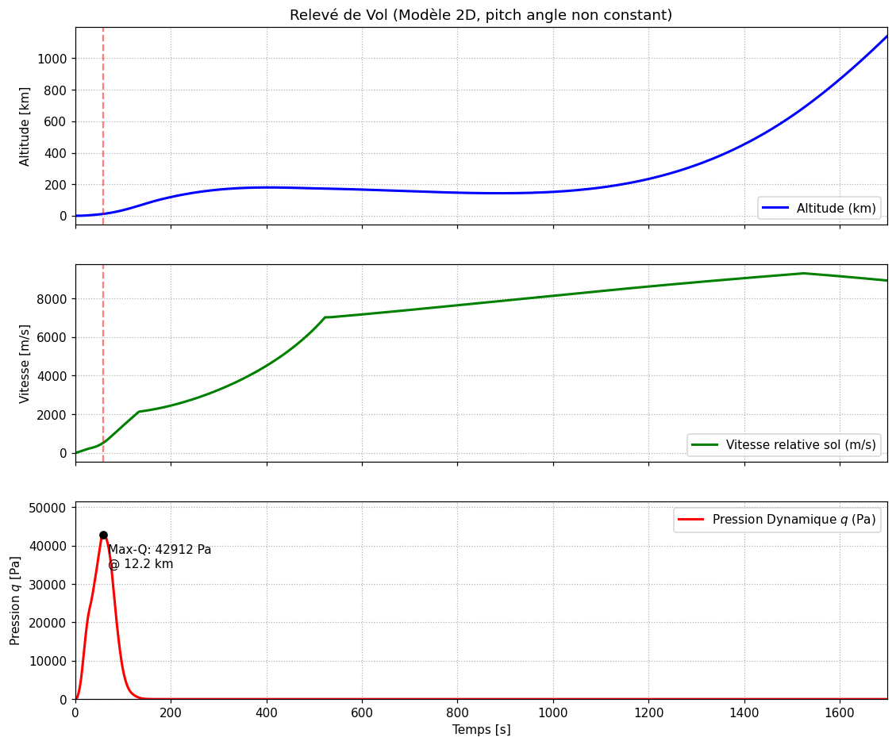
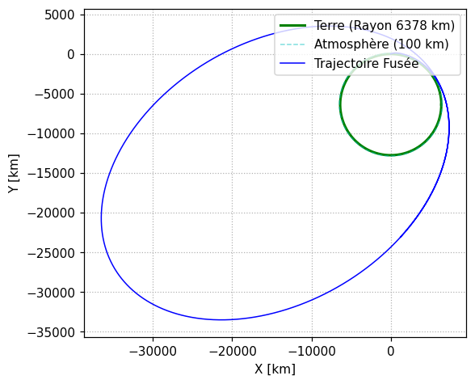

# Ariane 5 Flight Dynamics Simulator (2D)

Ce projet implémente un simulateur de trajectoire d'ascension pour le lanceur Ariane 5. Le script modélise les phases de vol, de l'allumage jusqu'à la mise en orbite, en prenant en compte les variations environnementales et les changements de configuration du lanceur.

<br>

**Fonctionnalités** :

- Gestion du largage des EAP (Boosters), de la coiffe et de l'EPC (Étage Principal).

- Modèle atmosphérique ISA (7 couches) et gravité variable en $\frac{\mu}{r^2}$ .

- Rotation de la Terre (départ de Kourou à ~463 m/s vers l'est, traînée relative à l'atmosphère).

- Coefficient de traînée $C_d$​ variable selon le nombre de Mach.

- Calcul automatique de la pression dynamique maximale (Max-Q) pour analyse.

- Calcul de l'orbite obtenue à l'extinction de l'ESC (périgée, apogée).

- Données du lanceur sourcées et calibration sur des vols réels (dossier `calibration/`).

<br>
<br>

**Structure du projet** :

```
main.py              # point d'entrée : simulation, rapport, graphiques
ariane5/
  constants.py       # constantes physiques, tables ISA et Cd(Mach)
  atmosphere.py      # modèle ISA, vitesse du son, Mach, Cd
  vehicle.py         # masses, surfaces, propulsion d'Ariane 5
  guidance.py        # loi de tangage
  propulsion.py      # phases de vol, poussée et débit massique
  dynamics.py        # second membre des équations du mouvement
  simulation.py      # intégration phase par phase (solve_ivp)
  analysis.py        # pression dynamique, Max-Q, orbite d'injection
  plotting.py        # rapport de vol et graphiques
calibration/
  reference.py       # repères de vols réels (avec sources)
  fit.py             # ajustement du modèle sur ces repères
docs/                # graphiques du README
```

Lancement : `pip install numpy scipy matplotlib` puis `python main.py`.

<br>
<br>

**Modèles Physiques** :

1. Équation de la dynamique

Le simulateur résout le principe fondamental de la dynamique dans le référentiel géocentrique supposé galiléen :
    
$$
m(t)\frac{dv}{dt} = T(P_a) + D(h,v) + m(t)g(r)
$$
    
Avec :
- $T$ la poussée, corrigée par la pression ambiante $P_a$.
- $D$ est la traînée aérodynamique.
- $g$ est le vecteur gravité au local dépendant de la distance radiale $r$ : $g = \mu / r^2$ avec $\mu = 3{,}986 \cdot 10^{14}\ m^3/s^2$. (La constante $g_0 = 9{,}80665\ m/s^2$ ne sert qu'à l'Isp et au modèle ISA.)

<br>

2. Modèle Atmosphérique (ISA)
   
Le code utilise le modèle International Standard Atmosphere pour calculer la densité de l'air $\rho$ et la pression $P$ jusqu'à 86 km. Il intègre la conversion de l'altitude géométrique $z$ en altitude géopotentielle $H$ :

$$
H = \frac{R_T \cdot z}{R_T+z}
$$

  Avec $R_T$ le rayon terrestre.

<br>

3. Déroulé du vol

Le simulateur suit la séquence réelle d'un vol GTO (temps depuis le décollage, qui a lieu à H0 + 7,3 s, H0 étant l'allumage du Vulcain 2) :
- 0 s : décollage, EPC + 2 EAP (le Vulcain 2 a déjà brûlé 2,4 t au sol).
- 135,2 s : séparation des EAP.
- 188 s : largage de la coiffe.
- 522,7 s : arrêt du Vulcain 2, puis séparation de l'EPC à 528,7 s.
- 532,7 s : allumage de l'ESC (Étage Supérieur Cryogénique) jusqu'à épuisement (~992 s), puis vol balistique.

<br>
<br>

**Hypothèses physiques** :

- Plan (x,y).
- Loi de commande d'attitude (Pitch) définie par interpolation linéaire d'une table (temps, angle), ajustée sur les vols réels.
- Terre parfaitement sphérique et tournante : le lanceur part avec la vitesse d'entraînement de Kourou (~463 m/s vers l'est, plan de vol assimilé au plan de latitude 5,24°) et la traînée est calculée par rapport à l'atmosphère en rotation. Les vitesses affichées (Max-Q, graphiques) sont relatives au sol, comme la télémétrie. Pas de Coriolis dans le calcul de la gravité (référentiel inertiel).

<br>
<br>

**Données du lanceur (Ariane 5 ECA)** :

Toutes les entrées de `ariane5/vehicle.py` sont tirées de sources publiques ; la masse au décollage, les masses larguées et la masse finale en sont **déduites** par bilan de masse.

| Élément | Valeur retenue | Source |
|---|---|---|
| EAP P241 (×2) | 240 t d'ergols, 33 t à vide | Wikipédia (273 t dont 33 t à vide) |
| EAP : propulsion | Isp vide 275,4 s ; 130 s ; pic 6 709 kN ; moyenne 4 984 kN | ESA bulletin 104 (essai au banc) |
| EAP : tuyère | diamètre de sortie 2,9 m | ESA (3,1 m hors-tout) |
| EPC H173 | 173 t d'ergols, 188 t au total | ESA bulletin 123 |
| Vulcain 2 | 1 359 kN vide, Isp 429 s (323 kg/s), sortie 2,09 m | Wikipédia Vulcain, étude tuyère double galbe |
| ESC-A | 14,7 t d'ergols, 4,54 t à vide | ESA, Wikipédia |
| HM7B | 64,8 kN, Isp 446 s | Wikipédia ; cohérent avec les 987 s de VA230 |
| Case à équipements | 1 370 kg (1 300 kg + 70 kg d'hydrazine) | ESA |
| Coiffe longue | 2,9 t | capcomespace |
| Charge utile | 10 731 kg (EchoStar 18 + BRIsat, SYLDA compris) | Spaceflight Now, vol VA230 |
| **Masse au décollage (déduite)** | **766 t** | Wikipédia : 777 t (valeur signalée « à préciser ») |

<br>
<br>

**Résultats** :

Vol de référence VA230 (orbite visée 250 × 35 766 km) :

```
Max-Q : 42,9 kPa à t = 58,6 s, altitude 12,2 km
Extinction ESC à t = 1 525 s, altitude 686 km, vitesse inertielle 9 795 m/s
Orbite : périgée 256 km, apogée 34 133 km
```

<p align="center">
  
  <br><br>
  
</p>

<br>
<br>

**Calibration sur vols réels** :

`python -m calibration.fit` compare le modèle à 14 repères d'Ariane 5 ECA (`calibration/reference.py`, chaque valeur avec sa source) et n'ajuste **que ce qui n'est pas publié** : la loi de tangage, la *forme* de la courbe de poussée des EAP (son impulsion totale reste celle des 240 t d'ergols et son pic celui de l'essai au banc) et un facteur d'échelle sur $C_d$. Options : `--reprise` (repart de la dernière solution), `--ecrire` (reporte la solution dans le code).

Les timelines publiées sont en H0 (allumage Vulcain) : tous les temps sont convertis en temps depuis le décollage (H0 + 7,3 s).

| Repère | Réel | Modèle d'origine | Modèle actuel |
|---|---|---|---|
| Mach 1 | 41 s, 6,8 km | 33 s, 5,1 km | 41,1 s, 6,4 km |
| Max-Q | H0+65 s = 57,7 s ; ~11-14 km | 39 s, 7,1 km | 58,6 s, 12,2 km |
| Poussée au décollage | 13,14 MN (1 340 t) | 13,4 MN | 13,1 MN |
| Séparation EAP | 67-69 km, 2,01 km/s | 99 km, 1,78 km/s | 66,7 km, 2,14 km/s |
| Largage coiffe | 107-111 km | 177 km | 110,8 km |
| Arrêt EPC | 160-210 km, 7,03 km/s | 604 km, 5,1 km/s | 172,5 km, 7,02 km/s |
| Extinction ESC | 1 520 s ; ~640 km | non atteinte | 1 525 s ; 685 km |
| Orbite | 250 × 35 766 km | altitude max. 12 364 km, puis retombe | 256 × 34 133 km |

Sources : Spaceflight Now (timelines VA213, VA220, VA230, Herschel/Planck), Arianespace (séquence GTO type, flyer Ariane 5), ESA (bulletin 123, pages EPC et case à équipements), Spaceflight101.

Corrections apportées au modèle :
- **Bilan de masse sourcé** : la masse au décollage n'est plus fixée à la main. Les masses à vide des EAP et de l'EPC, les ergols de l'ESC, la coiffe et la case à équipements viennent des sources ; l'EPC larguée emporte ses 1,8 t d'ergols résiduels.
- **Rotation de la Terre** : sans elle, le modèle n'avait pas l'énergie pour atteindre l'orbite (il manquait ~460 m/s).
- **Tuyères** : `A_E_EAP = 2.9` et `A_E_EPC = 3.0` étaient des diamètres notés comme des surfaces ; les surfaces réelles (6,6 m² et 3,4 m²) donnent une Isp au sol des EAP de ~247 s, cohérente avec les 250 s publiées.
- **Gravité** : $g_0 (R_T/r)^2$ remplacé par $\mu/r^2$ (la gravité était surestimée de 0,08 %, et incohérente avec le calcul d'orbite).
- **Séquence de vol réelle** : coiffe, arrêt du Vulcain 2, séparation EPC et allumage ESC aux instants publiés ; poussée HM7B de 64,8 kN au lieu de 67 kN, vérifiée par la durée de combustion de VA230.

<br>
<br>

**Regard Critique** :

- **Apogée** : il manque ~1 630 km à l'apogée (34 133 contre 35 766 km). Cela ne représente que ~30 m/s sur ~10 200 m/s au périgée (0,3 %), soit moins que l'incertitude des sources : l'Isp du Vulcain 2 vaut 429 ou 432 s selon les pages, ce qui suffit à représenter ~40 m/s. Aucune donnée n'a été retouchée pour fermer cet écart.
- **Vitesse à la séparation des EAP** : 2,14 km/s contre 2,01 km/s (VA220). C'est le seul repère hors tolérance : le calage arbitre entre ce repère et l'énergie nécessaire pour l'orbite. Cette vitesse provient d'un seul vol et d'une valeur arrondie (« 4 500 mph »).
- **Altitude pendant la phase ESC** : le modèle redescend brièvement à ~143 km avant que l'ESC ne fasse monter l'orbite. Aucun profil d'altitude publié ne permet de vérifier ce point entre l'arrêt de l'EPC et l'extinction de l'ESC.
- **$C_d$** : le facteur ajusté (0,78) donne un $C_d$ subsonique de 0,34, rapporté à la section EPC + 2 EAP (37,5 m²). Aucune donnée aérodynamique publiée ne permet de le vérifier.
- **Non-unicité** : la loi de tangage (10 angles) et la forme de la courbe de poussée des EAP (8 points) reproduisent les repères, mais ne sont pas uniques. Elles ne doivent pas être lues comme la vraie loi de guidage ni la vraie courbe de poussée. Seules leurs grandeurs globales sont contraintes (impulsion totale, pic de poussée, moyenne de 4 986 kN contre 4 984 kN mesurés).
- **Valeurs écartées** : la vitesse en fin d'EPC du vol VA229 (5 758 m/s) n'est pas compatible avec l'énergie d'une GTO pour un ESC de 14,7 t ; on retient celle de Herschel/Planck (7,03 km/s). Le bulletin ESA place le Max-Q « à T+65 s » mais compte en H0, d'où 57,7 s après décollage.
- **Modèle plan** : l'inclinaison de l'orbite (6°) et les effets hors plan ne sont pas modélisés.
